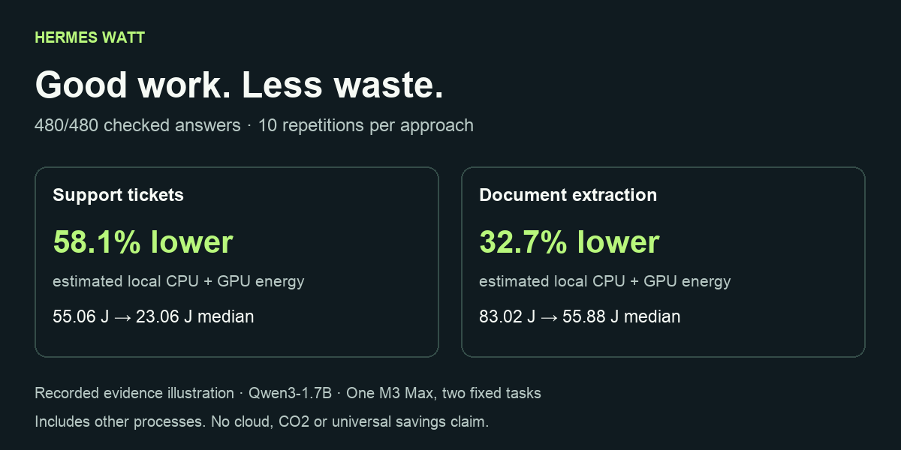

# Hermes Watt

**Good work. Less waste.** Energy receipts and quality-checked efficiency experiments for [Hermes Agent](https://github.com/NousResearch/hermes-agent).

Token counts tell you how much text moved. They do not tell you how much electricity AI used. Hermes Watt shows what can be estimated locally, keeps cloud energy explicitly unknown, and checks the answers before celebrating a more efficient workflow.

## What works

- A native Hermes Desktop page with task receipts, observed model requests, linked background calls, failures and duration.
- `/watt` for the latest receipt in the current conversation.
- Optional Apple Silicon CPU + GPU energy estimates, always labelled **estimated** and **system-wide**.
- **A comparison button inside the plugin:** choose support tickets or document extraction, give consent, and compare twelve separate requests with one batch. Choose 3, 5 or 10 repetitions per approach; stop safely at any time.
- No automatic model switching or prompt rewriting. The observer cannot modify agent output.

[60-second evidence replay](https://github.com/michaelversluis/hermes-watt/releases/download/v0.2.0/hermes-watt-evidence-v02.mp4) (recorded data, not a native screen recording) · [Actual /watt output](docs/evidence/watt-output.txt)

## Two real experiments, with boundaries

On an Apple M3 Max, Qwen3-1.7B-Q8_0 completed two fixed synthetic tasks. Each approach ran **ten times**, in alternating order, with the same answer checks:

| Task | Individual requests, median | Batched request, median | Correct answers, both approaches | Lower estimated local energy |
|---|---:|---:|---:|---:|
| Classify 12 support tickets | 55.063 J | 23.060 J | 240 / 240 | 58.1% |
| Extract invoice references and amounts from 12 fictional notes | 83.015 J | 55.884 J | 240 / 240 | 32.7% |

**480/480 answers passed.** In both experiments, every batched run used less estimated local CPU + GPU energy than every individual-request run. These are results for this machine, model and narrow workloads, including unrelated local activity. Model loading and warm-up are excluded. They are **not** measurements of total device electricity, cloud energy or CO₂, and do not establish a universal saving or statistical guarantee.

[Ticket samples](docs/evidence/qwen-1.7b-tickets-10.json) · [Extraction samples](docs/evidence/qwen-1.7b-extraction-10.json) · [Method and reproduction](docs/METHOD.md)

An [earlier 0.6B experiment](docs/evidence/qwen-0.6b-inconclusive.json) failed the answer checks and received **no saving claim**. The [original three-repeat 0.1.0 experiment](docs/evidence/qwen-1.7b.json) remains available as historical evidence; its 59.4% result is not reused for the new code.



## Try the comparison

1. Start an OpenAI-compatible model server on your computer. [Exact reproduction commands](docs/METHOD.md#run-it-yourself) use the pinned Qwen model and llama.cpp.
2. Open **Hermes Watt**, choose a task and repetition count, and tick the consent box.
3. Click **Test a lower-energy approach**. Progress appears while it runs; **Stop test** finishes the current request and preserves your previous result.

The plugin sends only its built-in fictional examples to a literal loopback endpoint. It never sends your conversations, downloads a model, chooses a cloud provider or changes your agent's model. The endpoint defaults to `http://127.0.0.1:18082/v1`; change it and the model name in Hermes Watt settings. Each profile permits only one active experiment. A failed or interrupted test preserves the last completed report.

## Install

Requires **Hermes 0.23.0 or newer**. Existing older Hermes installations must be upgraded separately. Nothing in this repository updates your agent automatically.

Copy the **pinned install command** from the [0.2.0 release](https://github.com/michaelversluis/hermes-watt/releases/tag/v0.2.0). It uses a full 40-character commit SHA, as required by `--ref`. Then enable the plugin:

```sh
hermes plugins enable hermes-watt
```

Catalog admission is pending; this is a direct repository install. Restart your Hermes session. Enable the agent plugin and Desktop plugin for the same profile, then choose **Hermes Watt** in the sidebar or command palette. After a task, `/watt` shows the conversation's receipt.

Request metadata stays local when the plugin is enabled. Hardware energy collection is **off by default**. Opt in through the plugin settings, or merge this into the active profile's `config.yaml` (preserve your other settings):

```yaml
plugins:
  enabled: [hermes-watt]  # append to your existing enabled list
  entries:
    hermes-watt:
      settings:
        recording: true
        local_energy: true
```

Restart the session after changing settings. On unsupported hardware, with collection disabled, or if the hardware backend fails, energy remains **Unknown**. Requests and receipts still work. Apple users may need Xcode Command Line Tools to build the pinned native dependency if no wheel matches their Python.

## Privacy and permissions

No cloud account, API key or telemetry service is needed. Ordinary observation stores metadata and optional hardware estimates locally; it never stores conversation prompts, responses, tool arguments or raw provider errors.

The Desktop API inherits Hermes authentication. Its explicit comparison action starts one bounded worker thread, sends synthetic examples to your configured loopback model server and saves the synthetic answers and result in this profile. It makes no external network calls and starts no shell process or model service. Experiment consent is separate from ordinary task-energy collection. The command uses the host-provided conversation identity. The development preview is loopback-only; never expose it to the internet. See [full disclosures](docs/PRIVACY.md).

## Development

```sh
python3 -m venv .venv
.venv/bin/python -m pip install -r requirements-dev.txt
.venv/bin/python -m pytest -q
npm ci --ignore-scripts
npm test
python3 scripts/stage.py /tmp/hermes-watt-package
hermes plugins validate /tmp/hermes-watt-package --install-deps
```

The staged package contains only runtime sources, README and license. Demo tools, test environments, model weights and local receipts are never installed with it. The repository also supports ordinary Git installation; its `.gitignore` excludes all local data.

For a local browser preview of the real Desktop component:

```sh
node demo/build.mjs
.venv/bin/python demo/serve.py --data /path/to/your/test-output
```

Open `http://127.0.0.1:18180`. This development adapter is not proof of native Desktop activation. [Verification status](docs/VERIFICATION.md) distinguishes the checks.

## What it deliberately does not infer

- A local CPU/GPU counter is not a cloud datacenter meter.
- Missing energy is not zero.
- Overlapping task windows cannot be summed as exclusive task energy.
- Token reductions alone do not prove energy reductions.
- A cheaper result that fails the answer checks is not an efficiency win.
- Ordinary task quality is **not assessed**; only the synthetic benchmark has answer checks.

Energy observability already exists in projects such as [Traceverse Hermes OTel](https://github.com/Mandark-droid/hermes-otel-plugin). Watt focuses on understandable task receipts and controlled, quality-checked workflow comparisons.

MIT license. Built by Michael Versluis for the Hermes Plugin Hackathon.
